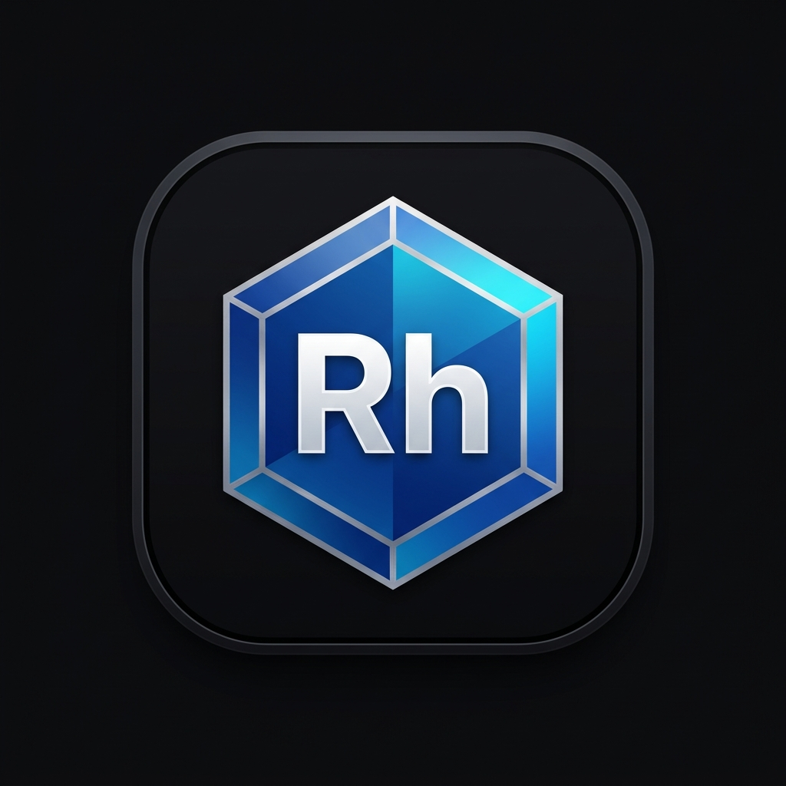

<div align="center">



# Rhenium

**Lightweight C++20 Win32 + WebView2 Desktop Framework — Zero Node.js Required**

[-f59e0b?style=for-the-badge)](https://github.com/irfandemir00/Rhenium)
[](https://github.com/irfandemir00/Rhenium)
[](https://github.com/irfandemir00/Rhenium)
[](https://developer.microsoft.com/en-us/microsoft-edge/webview2/)
[](https://github.com/irfandemir00/Rhenium)
[](LICENSE)

</div>

> [!WARNING]
> **Beta Software — Not Yet a Full Release (`v0.1.0-beta`)**
>
> Rhenium is currently in **active Beta development** and has **not reached a full `v1.0.0` release**.
> Public C++ and JavaScript APIs, `rhenium.json` configuration options, and `rhenium` CLI flags may change before `v1.0.0`.
> Bug reports, feedback, and pull requests are warmly welcomed!

---

## ✨ Why Rhenium?

Rhenium gives you the native speed and tiny footprint of **C++20 + Win32** paired with the iteration speed of **HTML, CSS, and standard ES2020 JavaScript** — without bundling Chromium or requiring Node.js/npm.

| Capability | What Rhenium Provides |
| :--- | :--- |
| **Thin C++20 Native Host** | Boot a full desktop app in one line: `rhenium::App::from_config_file("rhenium.json").run()`. |
| **Zero Node.js / Zero npm** | Write all UI, state, and application logic in standard ES2020 modules (`ui/js/`). |
| **Built-in `window.rhenium` Bridge** | Promise-based IPC for window controls, native dialogs, clipboard, scoped async filesystem, and shell URLs. |
| **Modern Frameless Win32 UI** | DWM dark titlebar, per-monitor DPI scaling, `[data-rh-drag-region]` dragging & double-click maximize, and 6px edge resizing. |
| **Dev Live-Reload & Release Packing** | **Debug:** `ReadDirectoryChangesW` with FOUC-free CSS hot-swap. **Release:** `rhenium_pack` embeds all UI assets into the `.exe` and serves them from memory over `https://rhenium.localhost/`. |
| **Security-First Defaults** | Origin-locked IPC (`https://rhenium.localhost`), `FsScope` filesystem allowlisting + read size cap, customizable CSP headers, and locked-down Release mode (no DevTools, default context menu, or browser accelerators). |

---

## 🚀 Quick Start

### 1. Minimal C++ Host (`src/main.cpp`)

```cpp
#include <rhenium/rhenium.hpp>

int main() {
    return rhenium::App::from_config_file("rhenium.json").run();
}
```

### 2. Configuration (`rhenium.json`)

```json
{
  "app_id": "com.example.myapp",
  "title": "My Rhenium App",
  "width": 1024,
  "height": 680,
  "min_width": 480,
  "min_height": 360,
  "resizable": true,
  "frameless": true,
  "dark_titlebar": true,
  "ui_dir": "ui",
  "security": {
    "fs_allowed_roots": [],
    "max_read_file_bytes": 16777216
  }
}
```

> [!NOTE]
> By default, `window.rhenium.fs` denies arbitrary disk access. Paths selected by the user via `dialog.openFile`, `dialog.saveFile`, or `dialog.openFolder` are automatically granted to `FsScope` for the session, or you can pre-configure `fs_allowed_roots` in `rhenium.json`.

### 3. JavaScript Frontend (`ui/app.js`)

```js
const rh = window.rhenium;

document.getElementById("open-btn").addEventListener("click", async () => {
  const filePath = await rh.dialog.openFile({ title: "Select a File" });
  if (filePath) {
    document.getElementById("output").textContent = await rh.fs.readText(filePath);
  }
});
```

---

## 🔌 `window.rhenium` JavaScript API

| Namespace | Methods |
| :--- | :--- |
| **`window.rhenium.window`** | `minimize()`, `toggleMaximize()`, `isMaximized()`, `close()`, `setTitle(title)`, `startDrag()`, `openDevTools()`, `reload()` |
| **`window.rhenium.dialog`** | `openFile(options)`, `saveFile(options)`, `openFolder(options)`, `messageBox(options)` |
| **`window.rhenium.clipboard`** | `readText()`, `writeText(text)` |
| **`window.rhenium.fs`** | `readText(path)`, `writeText(path, content)`, `exists(path)`, `stat(path)`, `listDir(path)` |
| **`window.rhenium.shell`** | `openExternal(url)` |
| **`window.rhenium.app`** | `getInfo()` |
| **Core IPC & Events** | `invoke(cmd, args)`, `on(eventName, cb)` *(built-in event: `rhenium:maximized`)* |

---

## 🛠️ Requirements & Building

### Requirements

- **OS:** Windows 10 / 11 with [Microsoft Edge WebView2 Runtime](https://developer.microsoft.com/en-us/microsoft-edge/webview2/)
- **Toolchain:** CMake `3.22+` and a C++20 compiler (Clang/LLVM-MinGW, GCC, or MSVC) — Ninja recommended

### Build & Run Tests

```powershell
# Debug build + CTest unit tests
cmake -B build-debug -G Ninja -DCMAKE_BUILD_TYPE=Debug
cmake --build build-debug
ctest --test-dir build-debug --output-on-failure

# Release build (embeds UI assets into the executable)
cmake -B build-release -G Ninja -DCMAKE_BUILD_TYPE=Release -DRHENIUM_EMBED_ASSETS=ON
cmake --build build-release
ctest --test-dir build-release --output-on-failure
```

### Showcase App & CLI

```powershell
# Launch the Enterprise Console showcase app
.\build-debug\examples\showcase\rhenium_showcase.exe

# Scaffold, run in dev mode (live-reload), and bundle a Release dist/ folder
.\build-debug\tools\rhenium_cli\rhenium.exe init my_app
.\build-debug\tools\rhenium_cli\rhenium.exe dev my_app
.\build-debug\tools\rhenium_cli\rhenium.exe build my_app
```

`rhenium build` produces `dist/<app>.exe`, `WebView2Loader.dll`, and `rhenium.json` ready for distribution.

---

## 📁 Project Layout

```text
include/rhenium/
  rhenium.hpp                # Umbrella public header
  core/                      # Config, Security & FsScope, AssetResolver, IpcRouter
  bridge/                    # Embedded window.rhenium JS SDK
  platform/                  # Win32 native dialogs/clipboard and Window host
  runtime/                   # App coordinator & worker pool
src/
  core/                      # Core library (rhenium_core)
  bridge/                    # runtime_js.cpp + builtin_commands.cpp (rh:*)
  platform/win32/            # WebView2 loader, Window host, FileWatcher, native Win32 APIs
  runtime/                   # app.cpp
tools/
  rhenium_pack/              # Static UI asset packer for Release builds
  rhenium_cli/               # CLI tool (init, dev, build)
examples/showcase/           # Showcase app with modular HTML/CSS/JS UI
tests/                       # Unit tests (rhenium_core_tests)
```

---

## 🗺️ Beta Roadmap (Toward `v1.0.0`)

- [x] C++20 ↔ JS Promise IPC (`IpcRouter` + `window.rhenium`)
- [x] Frameless Win32 window with dark titlebar, drag regions, edge resizing & per-monitor DPI
- [x] Debug live-reload (`ReadDirectoryChangesW`) & Release single-binary asset embedding (`rhenium_pack`)
- [x] `FsScope` filesystem allowlisting & read-size limits
- [x] Project scaffolding & bundling CLI (`rhenium init / dev / build`)
- [ ] Multi-window management & cancellable close events
- [ ] System tray icon & native context menus
- [ ] Windows 11 Mica / Acrylic backdrop & custom window icons
- [ ] Auto-generated `rhenium.d.ts` TypeScript definitions for IDE IntelliSense
- [ ] Binary `SharedBuffer` IPC & static `WebView2Loader` single-`.exe` option

---

## 🤝 Contributing

Rhenium is growing in Beta and contributions are always welcome!
See [`Contributors.md`](Contributors.md) for the contributor roster, development setup, and guidelines on opening issues or pull requests.

---

## 📄 License

Rhenium is open-source software licensed under the [MIT License](LICENSE).
